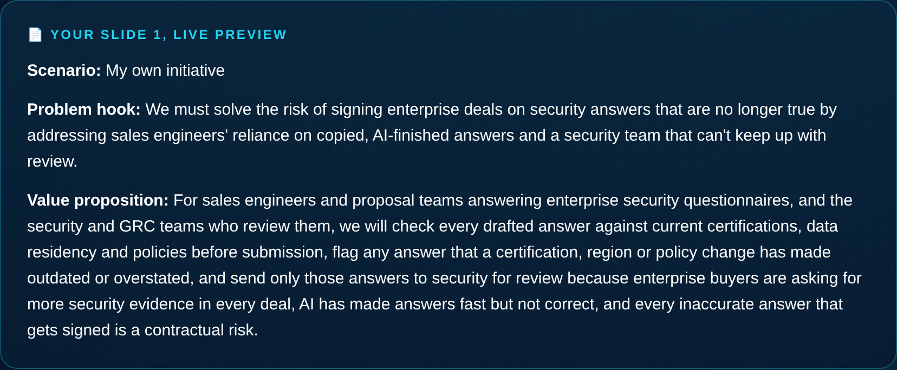

# Problem Hook & Value Proposition: Pre-submission check for security questionnaire answers

> **Module 1 · ★ Deliverable 1.** Repo file `01-product-thinking/problem-hook.md` — part of your submission.
> It becomes the **Problem, Value & Hypothesis** slide of your Module 6 final deck. (Your Module 1 · Exercise 1 discovery map lands in `strategic-map.md`.)

## 1. Chosen scenario

**Path:** My own initiative (B2B): a pre-submission check for security questionnaire answers

Security questionnaires sit in almost every enterprise SaaS deal, and AI has made answers faster to write but no easier to keep accurate. I picked this because it's a high-stakes B2B workflow I want to understand deeply.

## 2. The strategic crisis

> If we do nothing for 12 months, the company will keep submitting security answers that were true last year: an expired certification scope, a data residency option still in beta, a policy that has since changed. Those answers become part of the contract. Enterprise buyers who find a mismatch in due diligence or audit slow the deal or walk away, a wrong answer that gets signed becomes legal exposure, and the security team spends more of its week reviewing sales paperwork than securing the product. Questionnaire turnaround becomes the slowest step in late-stage deals.

## 3. The moment of misery

> The user is currently forced to paste answers from a questionnaire done eight months ago and let an AI assistant fill the gaps on a 250-question questionnaire due Friday. For a dozen answers they aren't sure (is EU data residency live yet? does the SOC 2 report cover the new product?), so they post in the security team's Slack channel and wait days, because security is answering the same questions for five other deals. Under deadline, some answers go out unchecked.

## 4. Problem hook

> We must solve the risk of signing enterprise deals on security answers that are no longer true by addressing sales engineers' reliance on copied, AI-finished answers and a security team that can't keep up with review.

Short version: *Our security questionnaire answers are copied from the past and finished by AI, so we're signing enterprise deals on answers that may no longer be true, and the security team has become a bottleneck that can't keep up.*

## 5. Value proposition

> For **sales engineers and proposal teams answering enterprise security questionnaires, and the security and GRC teams who review them**, we will **check every drafted answer against current certifications, data residency and policies before submission, flag any answer that a certification, region or policy change has made outdated or overstated, and send only those answers to security for review** because **enterprise buyers are asking for more security evidence in every deal, AI has made answers fast but not correct, and every inaccurate answer that gets signed is a contractual risk**.

## 6. Cold-read self-review

| Question | Your answer |
|---|---|
| Is the business risk high-stakes enough to justify a new initiative? | Yes. Answers become contract terms, delays hit late-stage revenue, and a wrong answer is legal and reputational exposure. |
| Is the moment of misery systemic, or just an edge case? | Systemic. Nearly every enterprise deal includes a questionnaire, and the posture changes whenever a certification, region or policy changes. |
| Does the value proposition actually remove the obstacle? | It targets the gap AI answer tools leave. They draft answers from whatever documents have been uploaded, and their freshness depends on someone uploading current ones. Nothing flags when a certification, region or policy change has made an answer the team already relies on untrue. This check is triggered by the change, not by the next upload. Module 2 needs to prove that against AI answer tools (Conveyor, Loopio, Responsive) and trust centres. |

## 7. Finalized hypothesis _(complete in Module 3)_

> Based on [qual + quant evidence], I believe that [solving X] for [persona] will result in [outcome], as measured by a [X%] change in [success metric]. I will protect [guardrail metric] and make a go/no-go decision after [decision window].

## Link to full artifact

- [Exercise 2 guide export](exercise-2-guide-export.md) (the `.md` the Module 1 · Exercise 2 Guide downloads)
- [Problem Hook Builder export](problem-hook-builder-export.md) (the `.md` the builder downloads)
- Slide 1 preview from the builder:

