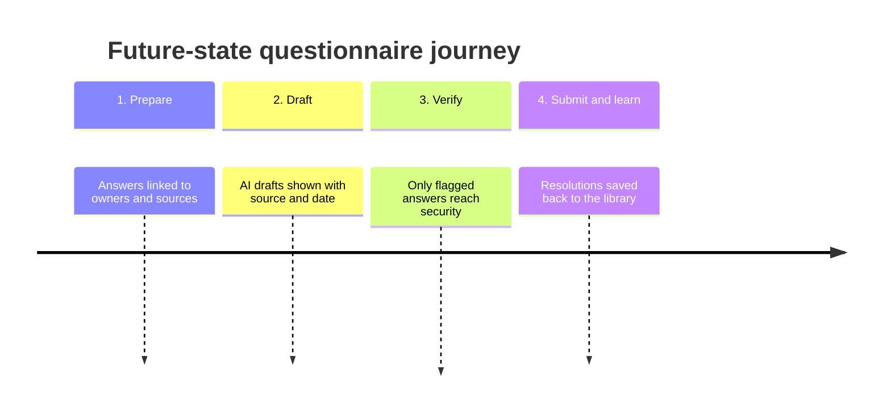

# Future-State Journey Map: Security Questionnaire Response

**Persona:** Sales engineer at a mid-market SaaS company, completing buyer security questionnaires against tight deal deadlines

**Goal:** Submit accurate questionnaire answers fast enough to keep the deal on schedule

**Trigger:** A certification, region or policy changes. Every answer it affects is flagged before anything is sent.

## Visual timeline

Plain-text version: `Change lands → [1 Prepare] → [2 Draft] → [3 Verify] → [4 Submit and learn] → next deal starts from verified answers`

## Stage 1: Prepare

* User action: Opens the new questionnaire and sees matched answers, each tagged with its owner.
   * Opens questionnaire, sees matched answers with owners → Starts from answers tied to live sources.
   * Copied answers arrive tagged with source and date → No more guessing how old an answer is.
* Internal state: Every library answer is linked to a certification, region or policy, with a named owner.
* Pain point addressed: Copied answers carry no provenance (H-01, H-02). Library entries have no owners (T-03).

## Stage 2: Draft

* User action: Reviews AI-drafted answers, each shown beside its source document and date.
   * Reads each draft beside its source and date → Judges freshness without trusting the tool blindly.
   * Edits drafts citing a superseded source → Stops an outdated claim from being drafted again.
* Internal state: AI drafts cite their source and date. Drafts drawing on a superseded source are marked.
* Pain point addressed: AI answers can't be traced to a source age (H-02, T-06).

## Stage 3: Verify

* User action: Clears unflagged answers in one pass. Sends only flagged answers to security, with the changed control attached.
   * Clears unflagged answers in one pass → Frees time for the few answers that carry risk.
   * Sends flagged answers with the changed control → Gives security a decision, not a Slack question.
* Internal state: A certification, region or policy change flags every affected answer. The security queue is ordered by deal stage and due date.
* Pain point addressed: Three-to-four-day Slack waits with no priority (T-02). The same questions asked again across deals (T-05).

## Stage 4: Submit and learn

* User action: Resolves each flag before sending. Each security decision is saved to the library.
   * Resolves every flag before submission → Stops "to confirm" answers going out unchecked.
   * Saves security decisions to the library → The next deal reuses the answer instead of re-asking.
* Internal state: Submission waits until flags are resolved. Each change is logged with owner and date.
* Pain point addressed: "To confirm" answers never revisited (H-05). Slack answers never saved back (T-05). Unchecked answers signed into contracts (T-01).

## Competitive advantages over the manual workaround

1. Flags affected answers when the change happens, not after a customer audit finds them (T-01).
2. Sends security only flagged answers, cutting repeat questions across concurrent deals (T-05).
3. Gives every answer an owner, source and date, replacing trust on faith with a check (H-02, T-03).

> Note: the research behind this map is assumed sample data. Validate each stage with real users before treating it as a target state.
